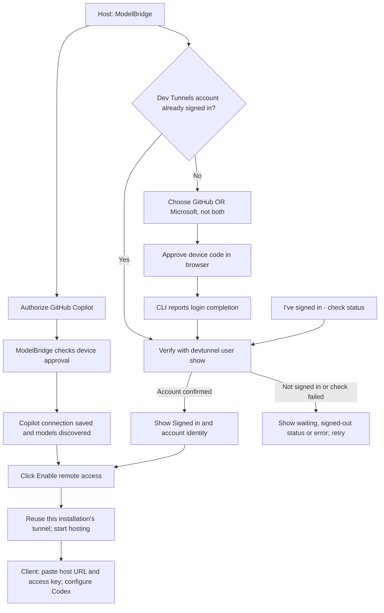

# ModelBridge

One desktop application for hosting a Copilot subscription and connecting
coding tools to local or remote models. Host and client are roles within the same
installation, not separate Gateway and Connector products.
The new desktop structure retains the original Copilot API's direct
authentication, token exchange, forwarding and protocol translations.
**There is no Copilot SDK integration.**

**Development pre-release: 0.1.7**, the latest ModelBridge release.

I download the unsigned Windows installer from the
[ModelBridge 0.1.7 release](https://github.com/rajathnaik/Copilot-API/releases/tag/modelbridge-v0.1.7):

- [Windows installer](https://github.com/rajathnaik/Copilot-API/releases/download/modelbridge-v0.1.7/ModelBridge.Setup.0.1.7.exe)
- [SHA256 checksum](https://github.com/rajathnaik/Copilot-API/releases/download/modelbridge-v0.1.7/ModelBridge.Setup.0.1.7.exe.sha256)

I compare `Get-FileHash .\ModelBridge.Setup.0.1.7.exe -Algorithm SHA256`
with the downloaded checksum before running the installer. Windows may warn
about an unknown publisher because this development build is not code-signed.
I use the same installer on the host and client machines. If 0.1.3 or later is
installed, I can use **Update to 0.1.7** in the app instead of reinstalling.

To build the unsigned Windows development installer locally, I run
`bun run --cwd apps/modelbridge package:win`. Its output is
`apps/modelbridge/release/ModelBridge.Setup.0.1.7.exe`. This is a test
candidate, not a verified production release; installation/upgrade/uninstall
and the real two-machine acceptance test are still pending.

## What's new in 0.1.7: tunnel reconnect and clearer connection errors

- **Dropped tunnels recover.** After sleep or a network change, the
  `devtunnel host` process could stay alive while the relay had **0 host
  connections**, so clients timed out. I now check the relay's host connection
  count (`devtunnel show`, a single management call that sends no traffic through
  the tunnel) when the PC wakes, when a local network adapter changes, and when
  the tunnel prints a connection warning. I confirm a missing host
  a second time before restarting sharing on the same URL. I back off retries
  (1, 2, 5, then 10 minutes), and I never restart the tunnel because a check
  itself failed.
- **No polling by default.** In **Settings → Tunnel reconnect**, I can turn
  automatic reconnect off or add a backstop check every 15, 30 or 60 minutes
  (Off by default). **Check tunnel now** on the host checks immediately and
  reconnects if needed, even when automatic reconnect is off.
- **Clearer client errors.** Discovery and request failures now name the
  cause, for example a timeout, DNS failure, refused connection, TLS failure or
  redirect, instead of a generic "check the endpoint". The diagnostics log
  records the full error cause chain.

## What's new in 0.1.6: credit-aware usage and client budgets

- **Copilot quota.** For token-based billing, I show GitHub's AI-credit
  allowance and consumption instead of calling them premium requests. I fetch
  fresh quota data when opening the dashboard, every minute while it is open,
  and when I select **Refresh quota**.
- **Token monitoring.** I refresh recorded token counts and the daily graph
  every five seconds after upstream requests finish. I can also select
  **Refresh usage**. Partial Messages usage updates retain cached input counts.
- **Client budgets.** I can set warn-only monthly AI-credit limits per client
  and per model. Missing credit reports are flagged as incomplete; requests
  are not blocked. Existing premium-request limits retain their original units
  until I explicitly change them.

## What's new in 0.1.5: longer turns and steadier model switches

- **Long turns.** A hard 120-second limit previously cut off the entire
  response, even while it was streaming. I now allow 120 seconds for Copilot
  response headers, then up to 5 minutes of silence between chunks. The client
  allows 5 minutes for its host to start and 5½ minutes of silence. Active
  streams can continue beyond those limits.
- **Thinking signatures.** Claude rejects unsigned or invalid thinking blocks.
  I no longer replay unsigned reasoning to Claude, and if it rejects a
  signature, I retry once without replayed thinking. Other chat models retain
  their unsigned reasoning text.
- **Missing tool-call IDs.** I reconnect a call and its output when their
  relationship is unambiguous and keep an orphaned ID-less output as context.
  When multiple calls cannot be matched safely, I return an explicit error
  instead of guessing which output belongs to which call.

## What's new in 0.1.4: switch providers mid-conversation

In Codex and any other Responses client, I can now switch between GPT and
Claude models in the same conversation, in either direction and as often as
I like. Before this, the switch failed with `web_search_call.id is required`,
"Invalid `signature` in `thinking` block", "encrypted content could not be
verified" or a compaction error. Each provider encrypts its hidden reasoning
and compactions so that only that provider can read them, and GPT and Claude
format tool and search IDs differently. ModelBridge now handles that:

- **Reasoning.** Reasoning translated from Claude carries a ModelBridge tag
  naming its model family. Each model receives only reasoning it can verify,
  and the other model's hidden reasoning is dropped (as VS Code does). The
  visible messages, tool calls, tool results and summaries are always kept.
- **Web searches.** Search steps replay with or without their IDs, and IDs are
  converted to a form the other provider accepts. GPT's own searches keep their
  page contents on OpenAI's side, so Claude sees each search's query or opened
  page and any cited sources, plus GPT's answer, but not the raw pages.
- **Compactions.** A Claude compaction reaches GPT as its plain-text summary.
  A GPT compaction is opaque, so before Claude continues from it, ModelBridge
  asks the web-search helper GPT model for the same handoff summary in plain
  text (one extra non-premium request, cached for later turns).
- Older conversations whose reasoning was recorded before the tag existed
  are handled too: if GPT rejects earlier-turn reasoning it cannot verify,
  ModelBridge retries once without it.

## What's new in 0.1.3: choose your folders, update in the app

- **Install folder.** The installer now asks where to install ModelBridge.
  The default is still `%LOCALAPPDATA%\Programs\ModelBridge`, which needs no
  administrator rights. Any folder you can write to works, for example
  `D:\Apps\ModelBridge`.
- **Data folder.** The next page asks where ModelBridge keeps its settings,
  sign-ins, access keys, hosts, usage history and logs. The default is still
  `%APPDATA%\ModelBridge`. If you pick another folder, the installer copies
  your existing data there and keeps the original folder. The data folder
  must be outside the install folder, because updates replace everything
  inside it. Keys are stored unencrypted, so choose a folder only you can open.
  The choice is saved in `HKCU\Software\ModelBridge` (`DataDir`) and in
  `data-location.txt` next to `ModelBridge.exe`, so updates keep using it.
  Silent installs accept `/D=<install folder>` and `/DATADIR=<data folder>`.
- **Move the data folder later.** Settings → Data folder → "Move data
  folder…" copies your data to an empty folder and restarts ModelBridge there.
  If Codex was set up, Apps then offers to point Codex at the new folder.
- **Updates.** ModelBridge checks GitHub for newer releases, including
  pre-releases, shortly after it starts and every six hours. "Update to X" in
  the header or in Settings downloads the installer, verifies its SHA-256
  checksum, closes ModelBridge, installs silently and reopens it. Updates keep
  your folders. This works from 0.1.3 onward; install 0.1.3 itself manually.
- The installer's "Recheck" button for the Dev Tunnels CLI is now fully
  visible, inside its own group with the CLI status.

## What's new in 0.1.2: every harness, not just Codex

Any tool that speaks the OpenAI Chat Completions or Anthropic Messages API can
now use every shared model with only the tunnel URL and access key. Before
this, those requests failed with HTTP 422 ("Cross-protocol adapters are not
enabled") unless Copilot happened to serve the model on that endpoint.

- **Chat Completions** (`/v1/chat/completions`) works for every model, which
  covers Hermes, Cline and other OpenAI-compatible tools. Claude, Gemini and
  other models that Copilot serves on Chat Completions are forwarded directly.
  GPT and other Responses-only models are translated: the request becomes a
  Responses request and the reply, including streamed tool calls and usage, is
  translated back. Reasoning summaries arrive as `reasoning_content`.
  Reasoning models ignore `temperature` and `top_p`, which Copilot rejects.
- **Anthropic Messages** (`/v1/messages`) works for every model, which covers
  Claude Code. Claude models go directly to Copilot's Messages endpoint. Other
  models are translated, and their reasoning is carried in the thinking-block
  signature so the next turn can continue it. The gateway also accepts the key
  in `x-api-key` and answers `/v1/messages/count_tokens` with an estimate.
- Claude tool schemas with a top-level `anyOf`, `oneOf` or `allOf` are
  flattened before they reach Copilot, which fixes "input_schema does not
  support oneOf, allOf, or anyOf at the top level".
- `/v1/models` lists the protocols each model serves in
  `modelbridge.protocols`. Clients forward those requests to the host
  unchanged; with an older host, the client translates them itself.
- Usage, premium-request counting and per-client limits apply to every
  protocol.

Example settings (the host needs this build; clients use their tunnel URL):

```yaml
# Hermes: ~/.hermes/config.yaml
providers:
  modelbridge:
    api: https://<tunnel-host>/v1
    key_env: MODELBRIDGE_API_KEY
    default_model: <source-id>/gpt-6.1-sol
```

```powershell
# Claude Code
$env:ANTHROPIC_BASE_URL = 'https://<tunnel-host>'
$env:ANTHROPIC_AUTH_TOKEN = '<access key>'
$env:ANTHROPIC_MODEL = '<source-id>/claude-sonnet-5.5'
```

Model IDs are the source-qualified IDs from `/v1/models`. On the host
machine itself, use `http://127.0.0.1:4321` with the local access key.

For Nod by n8n, select **Settings > Models > Add connection > OpenAI-compatible**
and enter `https://<tunnel-host>/v1` with the host's remote access key. Select a
tool-capable model with at least 64K context. The **host serving the tunnel**
must run 0.1.2 or newer: older hosts can list a model successfully but reject
its Chat Completions requests with HTTP 422 ("Cross-protocol adapters are not
enabled"). After updating, enable remote access again and reload the models
in Nod. This fixes the protocol mismatch; a full Nod automation run remains
a separate end-to-end acceptance check.

### Apps tab, Playground and per-app usage

The Codex tab is now an **Apps** tab with a dropdown of coding tools. On the
client, apps always talk to the local gateway (`http://127.0.0.1:4321`), which
forwards to your hosts, so the tunnel URL is never written into any tool.

- **Connection details.** The base URL, access key and every model ID have copy
  buttons. Host setup and Settings also have Copy URL / Copy key buttons.
- **One-click setup** for Codex, Claude Code (`~/.claude/settings.json`, `env`
  block), Hermes Agent (`config.yaml`, a `modelbridge` provider) and OpenClaw
  (`~/.openclaw/openclaw.json`, a `modelbridge` provider). ModelBridge previews
  a redacted diff first and changes only its own keys. It keeps the original
  values, so **Restore** puts back exactly what was there, removing the file
  if ModelBridge created it. Comments are kept in JSON and YAML. An OpenClaw
  JSON5 file that is not plain JSON loses its comments, and the preview warns
  about this first. Edits made outside ModelBridge are detected, and Apply
  refuses if the file changed after the preview. Other tools get copy-ready
  steps plus curl and Python examples.
- **Test connection** checks the gateway, the model list, each host (on
  clients), whether the app is set up, and a real one-line request through the
  app's API. The cheapest model is preselected.
- **Model sweep** (opt-in) sends one tiny request to each model you select.
  Models are listed with their premium multiplier and an estimated premium
  total, and you can stop the sweep after the current model.
- **Playground** tab: chat with any model through Chat Completions, Messages
  or Responses (the same APIs as Hermes, Claude Code and Codex). Choose the
  reasoning effort, output limit, streaming and a system prompt. Each reply
  shows its latency, tokens and the raw response, and any request can be copied
  as curl or Python.
- **Usage by app.** Requests are attributed to Codex, Claude Code, Hermes,
  OpenClaw, OpenCode, DeepSeek Harness, Playground or Other from the User-Agent or the
  `x-modelbridge-app` header, which the generated configs set. The Dashboard
  shows a per-app breakdown.

### DeepSeek Harness setup

Select **DeepSeek Harness (Web)** for `dsh web`, or **DeepSeek Harness
(Desktop)** for the standard desktop profile. Choose a model, preview the
changes, and apply. Open or restart that profile and start a new session.
ModelBridge does not install or sign in to DeepSeek Harness.

The setup uses Chat Completions at the local ModelBridge gateway and writes a
`modelbridge` provider with source-qualified model IDs. It edits only the
selected profile's `cordis.patch.yml` under `$DSH_HOME/profiles` (default
`~/.dsh/profiles`). The profile stores a credential reference; only the local
ModelBridge key is added to `$DSH_HOME/.credentials.yaml`. Other providers,
DeepSeek sign-in, and unrelated credentials stay in place. **Preview restore**
reverts the settings and credential reference owned by ModelBridge.

If DeepSeek Harness was launched with a different `DSH_HOME`, use that same
environment when starting ModelBridge. A custom profile, home-level patch, or
`--patch` override may use a different model configuration.

### OpenCode setup

Select **OpenCode** in **Apps**, choose a model, preview and apply. The setup
targets OpenCode 2.x and its shared local-server configuration used by the CLI,
Web interface and Desktop app. Restart the local OpenCode server and start a
new session after applying or restoring.

ModelBridge adds only `providers.modelbridge` and the default `model` in the
user's `opencode.jsonc` or `opencode.json`. JSONC comments, other providers,
native sign-ins and unrelated settings are preserved. The provider uses the
local gateway with source-qualified model IDs and only the local gateway key.
It exposes advertised model limits, input types, tool support and reasoning
efforts; models without token limits use conservative 32K context/8K output
limits.

The default directory is `~/.config/opencode`; `XDG_CONFIG_HOME` or
`OPENCODE_CONFIG_DIR` can override it. An existing JSONC file takes precedence
over JSON. Use the same directory environment for ModelBridge and the local
OpenCode server. Project settings and managed policies can override the user
configuration. This does not configure an OpenCode server running on another
machine or install OpenCode.

### Restore original app settings

Open **Settings > Restore app settings**, choose an app with a saved backup,
then select **Preview restore** and **Restore original settings**. This works
with Codex, Claude Code, Hermes Agent, OpenClaw, OpenCode, and both DeepSeek Harness
profiles, even when no models are available or the host is offline. Restart
the restored app and start a new session.

Restore reverts the values ModelBridge managed, preserves unrelated edits and
sign-ins, and refuses to overwrite a file that changed after previewing. It
needs the ModelBridge profile containing the backup and does not reset apps
configured manually. A malformed settings file must be repaired first.

## What's new in 0.1.1

- **No more duplicated replies in the Codex desktop app.** Copilot gives a
  streamed reply a new encrypted id in every event, so Codex showed each message
  twice (once while streaming and once when it finished). The gateway now keeps
  the first id for every event of an item. Updating the host is enough; clients
  benefit without changes.

## What's new in 0.1.0

0.1.0 is the first ModelBridge release. It includes everything in this README,
including the changes from the earlier development builds listed below.

- **Manage hosts on clients.** The client **Connect** tab is now **Hosts**. Each
  connected host has a card with its URL, model count, connection status and
  last check, plus **Check connection**, **Edit** and **Remove…**.
- **Edit keeps Codex working.** Rename a host or change its URL or access key in
  place. A new URL or key is verified with the host before it is saved, and the
  connection keeps its identity, so Codex's `model = "<source>/<model>"` route
  stays valid.
- **No more duplicate hosts.** Adding a host URL that is already connected
  reconnects that host (new key, refreshed models) instead of adding a second
  copy. Existing duplicates are flagged with a **Duplicate** badge; keep the one
  marked **Used by Codex** and remove the other.
- **Safe removal.** **Remove…** asks for confirmation, deletes the saved key and
  warns when Codex currently uses a model from that host.
- **Codex model list check.** The Codex tab notes when ModelBridge's models no
  longer match the applied Codex model list (offering **Preview Codex update**)
  or when Codex's default model is no longer available.

## Introduced in development build dev.7

These changes are included in 0.1.0.

- **Claude tool-schema fix.** Anthropic models rejected Codex tools whose input
  schema uses `oneOf`, `anyOf` or `allOf` at the top level
  (`input_schema does not support oneOf, allOf, or anyOf at the top level`).
  ModelBridge now flattens such schemas into a single object schema (merging
  properties and noting the alternatives in the description) before forwarding
  them to Messages and chat-only models.
- **One source per Copilot account.** Signing in to Copilot again with the same
  GitHub account now renews the existing source instead of adding a second one,
  keeping its label, sharing and web-search choices. On startup, existing
  duplicate sources for the same account are merged automatically, so the model
  list no longer shows every model twice.
- **Prompts and follow-ups.** Each request is tagged as a **Prompt** (you sent
  it) or a **Follow-up** (the agent continued after tool output), together with
  the Copilot premium requests it used, based on each model's billing
  multiplier. Only prompts use premium requests; follow-ups and web searches do
  not. The dashboard shows both counts, which makes it possible to tell real
  duplicate requests from normal agent continuations.
- **Named client machines.** Each client reports a name (by default its computer
  name; change it under **Settings → Client machine name**). The name is
  informational only; it is not secret and grants no access.
- **Clients and premium-request limits (hosts).** **Client machines this
  month** lists each client's last activity, requests and premium requests.
  Under **Client usage limits** I can set a default monthly limit per
  client, per-client overrides (or exempt a client) and per-model limits. Limits
  only warn: clients near (80%) or over a limit are flagged, but requests are
  never blocked.
- **Tokens-per-day line chart** with token and date axes, switchable between
  **Total**, **By model** and, on hosts, **By client**.
- **Host setup** has a dedicated **Choose the models clients can use** step with
  the full model-access controls.
- The **Web search helper** (formerly Web search model) is now labelled as what
  it is: the GPT model that runs web searches for Claude and other non-GPT
  models. It is not a default model.

## Introduced in development build dev.6

These changes are included in 0.1.0.

- Copilot discovery and inference now advertise the original Gateway's
  `vscode/1.139.1` compatibility version instead of the unsupported `1.109.0`.
  This addresses the reported HTTP 466 requirement for `1.109.2+`. The value
  belongs to ModelBridge's outgoing requests: updating locally installed VS Code
  does not change it. Live subscription inference still requires verification.
- **Models** (formerly Sources & models) lets you share all models or only
  selected models from each source. Expand **Model access** to choose a mode,
  select all current models, clear the selection, filter, or toggle individual
  models. The Host setup tab shows the shared-model count and links to these
  controls.

The policy applies to **all clients using the existing host key**. It restricts
both model catalogs and direct inference routes, so knowing a hidden model's ID
does not grant access. Local host tools retain access to every discovered model.
Changes affect new requests immediately; they do not cancel requests already
forwarded upstream. A client's cached catalog or Codex configuration may still
show a revoked model, but the host rejects its requests until access is restored
or another allowed model is chosen.

**All models** includes future discoveries automatically. **Only selected
models** retains the selection across restarts and refreshes; newly discovered
models remain private. An empty selection shares no models from that source.
Pausing **Share remotely** preserves the selection. Existing profiles without a
selection retain their previous all-model behavior. Each source's summary and
the model table show the effective remote access.

### Full model capabilities in every harness

Web search now works for every Copilot model, not only GPT models:

- **GPT models** (served by Copilot's Responses API) keep using Copilot's own
  hosted `web_search` tool unchanged.
- **Claude and other Messages/chat-only models** cannot use that hosted tool, so
  ModelBridge offers them an equivalent `web_search` function. When the model
  calls it, the host runs the query on a GPT model through Copilot's hosted web
  search, returns the answer with its source list to the model, and continues the
  turn. Codex sees standard `web_search_call` items with the query and sources.
  When the model also requests client tools in the same turn, the response ends
  after the searches so Codex can run those tools; the search results are kept
  on the host for 24 hours (up to 500) so replayed history stays complete.
- Each turn allows up to 8 searches. Each search gets its own 120-second limit,
  and each continuation request must start within 120 seconds and may then
  stream for as long as output keeps arriving, so a multi-step search turn is
  not cut short.
  A failed or timed-out search is reported to the model as a failed
  `web_search_call` rather than ending the turn; a failure while continuing
  after a search fails the response explicitly. The reported token usage is the
  final request's, which matches the conversation's real context size.
- **Models** shows a **Web search helper** for each Copilot source.
  **Auto** uses the newest full-size GPT model available (mini, nano and codex
  variants only when nothing else exists); you can pin a specific model instead.
  Searches run on the host, so the search model does not need to be shared with
  clients, and they count against the same Copilot subscription.

Codex catalogs also gained parity with the original Gateway: Codex-native
instructions (switching to compact instructions for every model, rather than
dropping models, when the catalog would exceed 1 MiB), discovered image input,
reasoning summaries, parallel tool calls, maximum output tokens and freeform
`apply_patch`. These capabilities are preserved across a remote host hop.
Before forwarding, the host removes tools Copilot rejects (`image_generation`),
strips client-only metadata, normalizes invalid image detail values and replaces
images larger than the model's advertised limit with a short note.

Live verification against a real subscription is still pending for the proxied
search path.

### Usage dashboard and host/client roles

The original Gateway's visibility is back, in the same app:

- **Roles.** On first start ModelBridge asks how this machine is used:
  **Host** (shares a Copilot subscription) or **Client** (uses another host).
  Existing installations pick their role from what is already set up. Switch at
  any time from the header or **Settings**; switching only changes the layout,
  never sign-ins, sources or sharing.
- **Focused tabs.** Host: Dashboard, Host setup, Models, Codex, Settings.
  Client: Dashboard, Connect, Models, Codex, Settings. Sharing controls appear
  only for hosts. The local gateway URL and key moved to **Settings**.
- **Dashboard.** Requests, failures, web searches, input/cached/output/reasoning
  tokens, estimated cost and average time for today, 7, 30 or 90 days, plus a
  tokens-per-day chart, a per-model breakdown, recent requests and, on hosts, a
  split between this machine and remote clients.
- **Copilot quota (hosts).** Premium-request, chat and completion allowances,
  remaining amounts, plan, account and reset date from GitHub's Copilot account
  endpoint. I fetch fresh quota data when opening the dashboard, every minute
  while it is open, or with **Refresh quota**. For token-based billing, I show
  **AI credits** and GitHub's reported credits used rather than labeling the
  allowance as premium requests. This is account-wide usage, including activity
  outside ModelBridge, and GitHub may update it with a delay.

I refresh recorded token totals and the graph every five seconds after upstream
requests finish, or immediately with **Refresh usage**. This does not estimate
tokens for a request that is still streaming. The dashboard shows its last
refresh time.

Under **Client usage limits**, I can choose **Copilot credits** for warn-only
monthly client and per-model budgets. Credits come from each response's reported
AI units (one billion nano AI units per credit); one credit is $0.01 USD.
Agent follow-ups also count when they report a credit charge. Missing credit
reports are flagged, never treated as proof of free usage. These budgets do not
block requests or change GitHub's billing limits. Existing saved premium-request
budgets keep their original unit until I explicitly save a different one;
changing units does not convert the numeric limits.

Accounting is per upstream request, so a web search or a tool-continuation round
that ModelBridge sends on your behalf is counted exactly once with its own
tokens, rather than hidden inside the client's turn. Requests whose provider
reported no token counts are shown as such, never as zero-cost usage.
**Estimated cost** uses the AI units Copilot reports with each response
(`copilot_usage.total_nano_aiu`), converted at the original Gateway's rate of
100 AI units per US dollar; requests without reported AI units are not priced
and the dashboard shows how many were. It is an estimate, separate from your
subscription's quota and from GitHub billing. A client records the usage of its
own requests; it shows cost only when its host passes Copilot's AI units
through.

Usage history holds metadata only (time, source, model, token counts, status,
duration and reported AI units, never prompts or responses). It is kept in
monthly files under `%APPDATA%\ModelBridge\usage`, retained for about 13
months, and can be deleted from **Settings**. The live Copilot quota response
can lag behind locally recorded requests. Client identity comes from the reported
machine name, not a separate authenticated per-client credential.

## Current implementation

- One Electron desktop application with its own Windows identity:
  `com.rajathnaik.modelbridge`.
- A local, authenticated gateway on `127.0.0.1:4321`.
- GitHub device-code sign-in for Copilot, subscription model discovery,
  short-lived Copilot token refresh, and forwarding to the account's service
  endpoint. Native Responses models and the inherited Messages/Chat
  Completions translators expose a Responses interface for Codex.
- Responses, Chat Completions and Anthropic Messages endpoints for every
  model: forwarded natively where the source supports the protocol, otherwise
  translated through the Responses API.
- API-source discovery and native Responses, Messages, and Chat Completions
  forwarding. Select the protocol the provider actually supports.
- Remote ModelBridge sources, source-qualified model IDs, and explicit
  routing. No silent fallback to another source, account, or paid API.
- An authenticated Codex-native catalog at `/v1/codex/models`, separate from
  OpenAI-style `/v1/models`. It exposes Responses models only, includes the
  required model instructions, preserves explicit tool/context capabilities
  across remote hops, supports ETag refresh, and enforces Codex's 1 MiB limit.
- Independently selected sources and models for sharing through a separate
  authenticated listener on `127.0.0.1:4322`.
- Credentials (access keys and the Copilot sign-in token) are stored
  **unencrypted** in `%APPDATA%\ModelBridge\credentials.json`, protected only
  by your Windows user account. This is a deliberate simplification for a
  personal tool; at-rest encryption is deferred. Codex obtains its local key by
  running the same installed ModelBridge executable in credential-only mode,
  so the key is still never written into Codex's TOML.
  There is no automatic import of old product settings. A profile encrypted by
  0.1.0-dev.0/dev.1 is archived to a `legacy-encrypted-*` folder on first start;
  the tunnel ID (and therefore the URL) is kept, but you must sign in to Copilot
  again and re-apply the Codex configuration.
- The window opens immediately and shows a startup state while the runtime
  starts. It is organized into role-specific tabs (see "Usage dashboard and
  host/client roles").
- Codex installation discovery, redacted configuration previews, named
  revisions, reactivation, native configuration restoration, external-edit
  detection and recovery of interrupted configuration writes.
- Microsoft Dev Tunnels provisioning and hosting with a persistent,
  installation-specific tunnel ID.
- Tray operation: closing the window keeps the local runtime available.
- English-only application and packaged Electron resources.

## Windows installation prerequisites

The installer asks how you intend to use this machine:

- **Use as a host:** a working Microsoft Dev Tunnels CLI is required before
  installation can proceed. Open the linked Microsoft installation instructions,
  install the CLI yourself (for example, `winget install Microsoft.devtunnel`),
  then click **Recheck** without closing the wizard.
- **Client-only for now:** no Dev Tunnels CLI is required. Add the remote host
  URL and access key in ModelBridge. You can install the CLI later if this
  machine should also host.

This choice checks prerequisites; it does not permanently restrict the app's
role. The installer validates the CLI offline using `--help`, not a sign-in or
live tunnel. Detection includes PATH, updated user/system registry PATH and
the standard user/machine WinGet links/package locations. No global PATH is
modified, no CLI is downloaded/bundled/upgraded, and Microsoft's terms must be
accepted separately. The CLI is proprietary software, not covered by the
MIT license of Microsoft's tunnel SDK.

Unattended installation (`/S`) defaults to client-only. Use `/S /HOST` to require
the host prerequisite; a missing/invalid CLI exits with code **2** before
installing ModelBridge. Successful CLI detection does not replace Microsoft
sign-in or verify subscription/tunnel connectivity.

Electron and its Node runtime are bundled. Bun is only a development/build
prerequisite. The app uses Windows PowerShell only asynchronously, to refresh
PATH when looking for the Dev Tunnels and Codex CLIs.

When you click **Install**, the installer checks whether ModelBridge is
already running using an in-process lookup (`nsProcess`). The stock
electron-builder check shells out to PowerShell/WMI without a timeout and could
hang indefinitely on machines where PowerShell or WMI is slow or held by
security software; ModelBridge overrides it in both the installer and
uninstaller.

Source discovery is not inference verification. Generic API and remote
sources forward their advertised protocol; Copilot has its own inherited
cross-protocol adapters. Some provider APIs require dedicated discovery
adapters or pagination; the generic source integration does not claim support
for every provider.

## Troubleshooting installation

The installer cannot write a log file: electron-builder ships NSIS without
logging support. If the wizard freezes, note the last page shown and check
Task Manager for a `ModelBridge.Setup…` process at constant CPU (a script loop)
versus child processes such as `powershell.exe` or `devtunnel.exe` (a waiting
external command). Builds before 0.1.0-dev.3 froze on entering the
prerequisite page when the user PATH did not end with `;`.

## Troubleshooting startup

ModelBridge writes a non-secret diagnostics log to
`%APPDATA%\ModelBridge\logs\modelbridge.log` (rotated at 512 KB). It records
startup timings, window responsiveness and renderer/child-process failures; it
never records keys or tokens. If the window stays on "Starting ModelBridge…" or
startup fails, check this file first. ModelBridge is single-instance: launching
it again focuses the running window, including one hidden in the tray.

## Troubleshooting client connections

When a client cannot reach its host, I first check the client's diagnostics log.
It now records why the request failed. If the failure is a timeout, I run
`curl.exe -I --max-time 15 "<host URL>/v1/models"` from both machines. If
the request also times out on the host, the relay has lost the host even
though sharing still looks active. I select **Check tunnel now** on the host
(or stop and start sharing). The URL stays the same. `devtunnel show <tunnel>`
should report at least one host connection. I keep the Dev Tunnels CLI current
(`winget upgrade Microsoft.devtunnel`), because older versions warn on every
command.

## Pending live verification and subsequent work

Real Copilot subscription inference through a live Dev Tunnel on two machines
has not yet been verified. Automated tests use synthetic providers and
isolated profiles, not a real subscription. Claude Code/OpenCode/Hermes/OpenClaw
discovery and setup, other subscription providers, account-specific allowances,
per-consumer remote keys, key rotation controls, and release/update automation
remain subsequent implementation milestones. Claude subscription integration
requires a separate feasibility and permitted-use assessment.

The development installer has been built and its unpacked executable has been
smoke-tested outside the workspace, including helper key retrieval while
the app runs, authenticated inference and packaged attribution. The prerequisite wizard has been tested with isolated missing/invalid/working
CLI fixtures and the full installer has been opened and cancelled before
installation, including detection of this host's installed CLI. An isolated variant of the
installer (different app ID/product name) has been silently installed,
reinstalled over a running app, and uninstalled without starting PowerShell;
upgrading a real dev.0/dev.1 installation still runs that build's old
uninstaller, which uses the stock PowerShell check. Existing
installations and historical Git/releases have not been removed. Codex
configuration is modified only after approving an explicit preview.

## What changes in Codex

On the client, add the host URL and host access key in ModelBridge (**Hosts**
tab). It discovers
the host's shared models and exposes them through its own local gateway.
Discover the installed Codex, choose a model and configuration name, and use
**Preview exact Codex changes** before applying.

ModelBridge edits the user-level `CODEX_HOME\config.toml` (normally
`%USERPROFILE%\.codex\config.toml`):

- `model_provider = "modelbridge"` selects the custom provider.
- `model` selects an exact source-qualified route, not a ChatGPT model alias.
- `[model_providers.modelbridge]` points `base_url` to the local `/v1` gateway,
  uses `wire_api = "responses"`, disables OpenAI authentication and websockets,
  and identifies the authenticated native model catalog URL.
- `model_catalog_json` points to a model-metadata snapshot, allowing Codex's
  picker to discover these models at startup.
- The provider's `auth.command` runs ModelBridge in credential-only mode with
  the explicit ModelBridge profile path. Its stdout is the local key, not a
  JSON envelope. Neither the host key nor Copilot token is stored in Codex.
- Reasoning/context settings are adjusted to the selected model's advertised
  capabilities. Unrelated TOML settings/comments are preserved.

The preview shows the current and proposed TOML with secrets redacted.
Revisions and the original managed settings are stored in ModelBridge's
profile. Restore native settings returns the owned fields/provider to their
original values while preserving later unrelated edits. External changes to
managed fields require explicit acknowledgement instead of being overwritten.
The app does not edit Codex's `auth.json`, sign you out, or add entitlement to
your ChatGPT subscription. Project/profile/CLI/managed settings can override
user-level configuration; restart Codex and start a new local chat after
switching because existing threads can retain their provider.

## How remote URLs work

ModelBridge does not invent a public hostname. On explicit **Enable remote
access**, it asks the Microsoft Dev Tunnels CLI to create or reuse its owned
persistent tunnel, registers the sharing port, and starts a host process.
Microsoft assigns the HTTPS URL; ModelBridge reads the sharing port's address
from `devtunnel host` output and waits for **Ready to accept connections**.
The CLI's `show` and `port show` metadata may omit public URLs, even when the
port is configured correctly; a missing metadata URL is not a sign-in failure.
Both a validated HTTPS URL for the sharing port and the ready signal are
required before ModelBridge reports sharing as active. It never constructs
a hostname from the tunnel ID or displays an inspection URL as the API URL.
The URL is reusable while the tunnel identity and port remain valid, but it is
not guaranteed permanent if the service resource expires or is recreated.

The relay permits anonymous transport access so a consumer only needs the host
URL and **ModelBridge host access key**. That does not mean the API is
unauthenticated. Local-client and remote-host keys are separate, and the
remote listener exposes only sources explicitly selected for sharing.

The host needs Microsoft's separately installed CLI and a one-time Dev Tunnels
sign-in. Dev Tunnels accepts a **GitHub account** (for example, the one you use
for Copilot; `devtunnel user login -g -d`) or a **Microsoft account**
(`devtunnel user login -d`). ModelBridge shows the account the CLI is already
signed in with (`devtunnel user show`), so you only sign in again to switch
accounts or after the CLI's sign-in expires. This sign-in only lets the host
own the tunnel; it is separate from the Copilot sign-in, and clients never sign
in to Dev Tunnels.

The host shows **Waiting for approval...**, **Checking sign-in...**, then a
disabled **Signed in** button with the account name and provider. The CLI
reports device-login completion; ModelBridge then runs `devtunnel user show`
to verify it. No browser callback URL is required. The UI refreshes every two
seconds. **I've signed in - check status** (or **Check sign-in status**) repeats
that verification manually, including after signing in outside the app. It
does not assume success from the button click. A failed check displays the
error rather than claiming the account is signed out or signed in. Signing in
does not start sharing: **Enable remote access** remains a separate action.
Copilot also uses device authorization: ModelBridge polls for approval and
confirms **Signed in** after saving the connection and discovering models.



The same GitHub account can perform both authorizations, but they grant access
to different services and use separate credentials. A Microsoft account is
optional, not an additional requirement. Signing in to Dev Tunnels alone does
not grant access to Copilot or confirm that sharing is running.

The installer's host prerequisite page checks the CLI and links to manual
installation instructions; ModelBridge offers device-code sign-in but does not
install software automatically. The client does not need this CLI. Both the
ModelBridge runtime and tunnel-host process must remain running.
[Microsoft's CLI reference](https://learn.microsoft.com/azure/developer/dev-tunnels/cli-commands)
describes provisioning, access controls, and service limitations. Dev Tunnels
is a preview service without a production SLA.

## Development

Requires Bun 1.4.2 and Node 22.18+; Windows is the first validated desktop
platform. Electron is pinned to 43.4.1.

### Command-line interface

The GUI and CLI control the same ModelBridge runtime and data folder. The CLI
does not import old products or keep a second copy of your connections.
Build this version before using the development CLI:

```powershell
bun run build
bun run cli --help
bun run cli start
bun run cli status
bun run cli models --json
```

`start` launches the runtime headlessly and reuses it if already running.
`serve` runs it in the foreground; Ctrl+C stops it. `open` opens the GUI on
that same runtime. `stop --yes` shuts down the local gateway and sharing
gracefully. A GUI from an older build must be closed before starting this
version. Do not run older and newer versions against the same profile.

The Windows package includes `bin\modelbridge.cmd` in the installation,
using Electron's bundled Node runtime; Node and Bun are not required on the
installed machine. The installer adds the chosen install folder's `bin`
directory to your user PATH, so a newly opened terminal can run:

```powershell
modelbridge --help
modelbridge start
modelbridge status
modelbridge models --json
```

Close and reopen your terminal after installing (restart the terminal app or
editor if it keeps the old environment). Reinstalling does not add duplicates,
and moving the installation replaces its previously added entry. Uninstalling
removes only ModelBridge's owned entry, preserving unrelated entries and any
matching entry you added yourself. The machine-wide PATH is never changed.
If your PATH cannot be updated safely, the installer reports it and leaves it
unchanged; you can still invoke `bin\modelbridge.cmd` from the install folder.

All commands accept `--user-data-dir <folder>` to select the same isolated
profile switch as the GUI, and `--json` for machine-readable results.
The packaged default comes from `data-location.txt`; the development default
is `%APPDATA%\ModelBridge`. The CLI requires this version's running runtime
and uses a separate local administration key, not either inference access key.
No administration endpoint is exposed through the HTTP gateways or tunnel.

```powershell
# Use an isolated profile without changing your normal setup.
bun run cli --user-data-dir D:\ModelBridge-Test start
bun run cli --user-data-dir D:\ModelBridge-Test role client
bun run cli --user-data-dir D:\ModelBridge-Test sources add --file host.json --key-env MODELBRIDGE_HOST_KEY
bun run cli --user-data-dir D:\ModelBridge-Test apps setup opencode --model "<exact-source/model-id>"
bun run cli --user-data-dir D:\ModelBridge-Test apps apply opencode "<preview-id>" --yes
bun run cli --user-data-dir D:\ModelBridge-Test apps restore opencode --apply --yes
bun run cli --user-data-dir D:\ModelBridge-Test stop --yes
```

Source inputs use the same contracts as the GUI. For example, `host.json`:

```json
{
  "label": "My host",
  "kind": "remote",
  "baseUrl": "https://<host-url>",
  "protocol": "responses",
  "shared": false
}
```

`--key-env` supplies the key without putting it on the command line. Inputs
may use `--file -` for JSON from stdin. Other commands cover source editing,
refresh and sharing selection; Copilot and Dev Tunnels device sign-in; relay
checks; usage, quota and budgets; Codex discovery/revisions; updates and data
folder management. Run `--help` for their exact input forms. Device sign-in
is asynchronous: approve the printed URL/code, then check `copilot status`
or `tunnel check-login`.

Harness setup/restore uses the GUI's redacted previews and stale-file checks.
Preview IDs survive a CLI process exiting but expire when another preview
replaces them or the runtime restarts. `--apply --yes` approves the fresh
preview in one command. `keys show <local|remote> --yes` explicitly reveals a
gateway key; normal command output never includes keys.

`request --path /v1/responses --file request.json` provides terminal Playground
access. Requests retain their complete JSON history and tools, and streamed
chunks are passed through without a total request deadline. Ctrl+C disconnects
that request. Request output can include user-supplied prompts/responses, so
keep terminal captures private. Model requests can consume provider credits.

```sh
bun install --frozen-lockfile
bun run dev
bun run build
bun run lint:all
bun run typecheck:all
bun run test
```

`MODELBRIDGE_PORT` overrides the local port; `0` selects an ephemeral port for
tests. Sharing uses port 4322. The desktop defaults to
`%APPDATA%\ModelBridge`; `--user-data-dir` explicitly selects an isolated
profile. `credentials.json` holds keys in plain text; do not share or commit it.

Missing or corrupt profile metadata/credentials are explicit failures, not
permission to silently regenerate keys. Preserve the affected profile for
recovery, or choose a fresh isolated profile for a new setup.
Interactive profile recovery is a later milestone.

The Windows native restart test uses a temporary Electron application/profile
and a synthetic provider. After building, run it from PowerShell:

```powershell
node .\scripts\ensure-electron.mjs
if ($LASTEXITCODE -ne 0) { throw 'Electron binary initialization failed.' }
$env:MODELBRIDGE_TEST_ELECTRON = node -p "require('electron')"
Set-Location apps\modelbridge
bun test .\tests\native-profile.test.ts
```

It verifies authenticated inference, credential storage, the actual
credential-only executable mode and stable local-key hashes across two
graceful application launches. It never provisions live
tunnels or modifies existing user profiles.
With `MODELBRIDGE_TEST_CODEX` also set, it clicks the real desktop's discovery,
preview, apply and restore controls, exercises revision reactivation, and
checks that the synthetic native account remains unchanged. Applying also
checks the helper while the app is still running, including a fresh profile.

To repeat the packaged-runtime test, set `MODELBRIDGE_TEST_PACKAGED_EXE` to the
build's `release\win-unpacked\ModelBridge.exe` and run
`bun test .\apps\modelbridge\tests\packaged-profile.test.ts` from the repository
root. It uses synthetic credentials and temporary ModelBridge/Codex profiles;
it does not install the app or modify existing user profiles.

The installer prerequisite tests are also opt-in. After packaging, point
`MODELBRIDGE_TEST_NSIS` at the cached NSIS `makensis.exe` and
`MODELBRIDGE_TEST_INSTALLER_EXE` at the built installer, then run
`bun test .\apps\modelbridge\tests\installer-prerequisites.test.ts`.
The native harness checks missing/invalid/working CLI handling, host/client
gating, recheck, cancellation and unattended exit codes using temporary
fixtures. The full wizard test opens the actual installer and cancels before
installation; it never clicks Install. Set `MODELBRIDGE_TEST_EXPECT_CLI=1`
on a known-ready host to require successful real CLI detection too.
This does not prove actual installation, upgrade or uninstall.

### DeepSeek Harness smoke test

With the official `@deepseek-ai/dsh` installed separately and supported Node.js
on `PATH`, point `MODELBRIDGE_TEST_DSH` at that package's `lib/bin.js`.

```powershell
$env:MODELBRIDGE_TEST_DSH = 'C:\path\to\@deepseek-ai\dsh\lib\bin.js'
bun test .\packages\runtime\tests\deepseek-cli.test.ts
```

For an installed Windows Desktop build, point the same test at the
installed executable instead. It uses Desktop's bundled headless runner:

```powershell
$env:MODELBRIDGE_TEST_DSH_EXE = "$env:LOCALAPPDATA\Programs\DeepSeek Harness\DeepSeek Harness.exe"
bun test .\packages\runtime\tests\deepseek-cli.test.ts
```

The tests use the real headless runner with the generated Web and Desktop
profile patches, temporary DeepSeek homes, and a synthetic local model. They
verify that both patches work and roll back. They do not sign in, send paid
requests, or open either DeepSeek Harness GUI.

### OpenCode smoke test

Point `MODELBRIDGE_TEST_OPENCODE` at a separately installed OpenCode 2.x
executable and run:

```powershell
$env:MODELBRIDGE_TEST_OPENCODE = 'C:\path\to\opencode.exe'
bun test .\packages\runtime\tests\opencode-cli.test.ts
```

The test starts a private OpenCode server, loads the generated provider, reads
a harmless fixture file through a model tool call, and streams the follow-up
reply through the local gateway. It uses isolated
config/data/cache directories and never reads a real account or sends a paid
request. Web and Desktop GUI acceptance remains a separate live check.

### Codex compatibility proof

Validated against the installed Windows desktop package **26.1002.7124.0**
and its bundled **codex-cli 0.162.0-alpha.2**:

- Actual app-server `model/list` discovers the source-qualified catalog.
- Complete Responses streams route two distinct models through an authenticated
  synthetic Copilot service -> sharing gateway -> consumer gateway -> Codex.
  The repeatable backend test covers native Responses plus inherited
  Messages and Chat Completions adapters.
- Codex executes an offered, harmless `exec_command` on the consumer and returns
  its matching `function_call_output`; the provider then completes the reply.
- Separate native desktop inspection confirmed that its picker displays both
  models as enabled options, and
  selecting the second updates its active model label.
- A synthetic native-account fixture remains byte-for-byte unchanged. These
  tests never read, copy, or edit a real account or harness profile.
- The backend/tool test uses the actual managed TOML/catalog and command-auth
  contract, then restores the synthetic native configuration.

The repeatable opt-in backend/tool test requires a separately installed Codex
console CLI.

```powershell
$env:MODELBRIDGE_TEST_CODEX = 'C:\path\to\installed\resources\codex.exe'
bun test .\apps\modelbridge\tests\codex-compatibility.test.ts
```

The separate desktop inspection used an isolated `CODEX_HOME`, isolated
Electron user data, a loopback debugging endpoint, and synthetic credentials;
it did not submit a paid request. Native GUI automation is not yet a repeatable
regression check: this desktop build can launch different first-run onboarding
flows before reaching Codex. Its GUI executable is selected from the package
manifest, not inferred from a file named `Codex.exe`.
This proves compatibility for that version, not universal desktop support,
real subscription hosting or native sign-in preservation with a real account.
Those remain live smoke-test milestones. The native desktop's cloud-only features may still require its
original ChatGPT sign-in independently of a custom local provider.

## Source boundaries

| Location | Responsibility |
| --- | --- |
| [apps/modelbridge](apps/modelbridge/) | Desktop lifecycle, IPC, UI, profile composition, tray and CLI process management |
| [packages/runtime](packages/runtime/) | Validated source contracts, explicit routing, gateway authentication, streaming, credential storage abstraction and tunnel provisioning |
| [tests](tests/) | Product identity and architectural boundaries |
| [scripts](scripts/) | Electron bootstrap, lint conventions and ModelBridge icon generation |

The desktop bundles runtime and renderer dependencies at build time. Packaged
execution does not depend on workspace symlinks or TypeScript source files.

The inherited application shells, CLI, plugins, Docker setup, old guides and
legacy release workflows have been retired from the active source tree. They
remain available in Git history. No remote release assets or tags are deleted.
ModelBridge releases use `modelbridge-v<version>` and require explicit
approval of the product/version after validation.

## Windows release assets

Publish a release or pre-release with a `modelbridge-v<version>` tag that
matches the workspace version and points at the tested commit containing the
**ModelBridge Windows Release** workflow. The workflow builds from that commit,
runs the checks and packaged smoke tests, then attaches
`ModelBridge.Setup.<version>.exe` and `ModelBridge.Setup.<version>.exe.sha256`
to the release. It does not create releases, move tags, or replace existing
assets. Watch the run in **Actions** before distributing the release.

Once the workflow is on the default branch, use **Actions > ModelBridge
Windows Release > Run workflow** on the intended release source to prepare
a candidate for install and upgrade validation. This only builds and saves
the two files as a downloadable workflow artifact; it does not modify any
release. If immutable releases are enabled, attach both files from that
artifact to the draft **before** publishing, since GitHub locks the release
assets at publication.

[MIT license](LICENSE) · [Lineage and responsible use](NOTICE.md)
